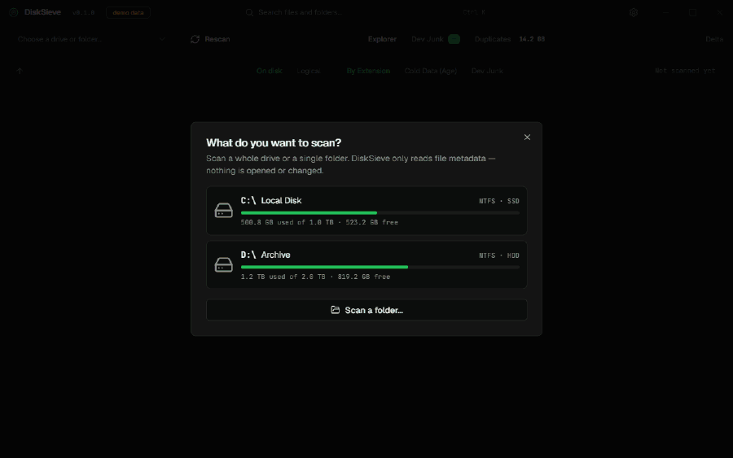

<div align="center">


# DiskSieve

**A fast, offline disk space analyzer for developers and power users.**

It answers not only *“what is taking up space?”*, but also *“what can I safely delete?”* and *“what has grown since last time?”*.

[](https://github.com/DiskSieve/disksieve/actions/workflows/ci.yml)
[](LICENSE)

[](https://github.com/DiskSieve/disksieve/releases/latest)


<br />



</div>

> [!WARNING]
> DiskSieve is in early development: `v0.1.0` is the first public MVP. Installers are not code-signed yet, so your OS will warn on first launch (see [Installation](#installation)).
> Scanning is read-only. The only action that changes your disk is **Move to Trash**, which always asks first, is checked by the backend and can be undone on Windows and Linux.

---

## Table of contents

- [Why DiskSieve?](#why-disksieve)
- [Features](#features)
- [Project status](#project-status)
- [Roadmap](#roadmap)
- [Installation](#installation)
- [Keyboard and mouse](#keyboard-and-mouse)
- [Getting started](#getting-started)
- [Architecture](#architecture)
- [Safety and privacy](#safety-and-privacy)
- [Performance targets](#performance-targets)
- [Contributing](#contributing)
- [License](#license)

## Why DiskSieve?

Existing tools show *what* takes up space, then leave you alone with the harder questions:

1. **“Can I delete this?”** — size alone does not tell a rebuildable cache from a critical system file.
2. **“What grew?”** — disks fill up gradually, and a one-off scan shows no trend.
3. **“How much space do my projects waste?”** — `node_modules`, `target/` and `.venv` in projects untouched for a year, plus global tool caches (npm, Cargo, Gradle, Docker), often add up to tens of gigabytes.

**DiskSieve aims for WizTree-class speed, DaisyDisk-class UX, and the decision context nobody else offers — on every OS, open source and fully offline.**

| Tool | Strengths | What DiskSieve adds |
| :--- | :--- | :--- |
| WizTree | Fastest scan on Windows (MFT) | Cross-platform, open source, safety advice, history |
| WinDirStat / SpaceSniffer | Classic treemap | Faster multi-threaded scan, advice, delta |
| DaisyDisk | Beautiful UX, deletion basket | Free, Windows and Linux |
| ncdu / dust | Fast, terminal | GUI, safety verdicts |
| npkill / kondo | Project artifact cleanup | The whole disk in context, not only artifacts |
| Czkawka | Duplicates and cleaners | Treemap and disk structure analysis |

## Features

✅ available now · 🚧 in progress · 🗓️ planned

| | Feature | Description |
| :---: | :--- | :--- |
| ✅ | **Multi-threaded scanner** | Parallel directory walker (`rayon`, one thread per logical CPU). Counts both logical size and size on disk, stays on one file system, never follows symlinks or junctions, and is cancellable at any time. |
| ✅ | **Live progress** | Files, folders, bytes and the current directory streamed ~10× per second. Permission errors never stop a scan — they are counted and reported. |
| ✅ | **Interactive treemap** | Drill down by clicking tiles or list rows, with breadcrumbs and an “up” button. Each view shows the 200 largest items plus one aggregated **Other** tile. |
| ✅ | **Size on disk vs. logical size** | One toggle switches between allocated space (clusters, compression, sparse files) and apparent size. |
| ✅ | **Color modes** | *By extension* (file categories) and *Cold Data* (age of the newest file in each folder). |
| ✅ | **Drive picker** | Mounted volumes with usage bars, or any single folder via the native picker. |
| ✅ | **App shell** | Custom title bar, startup “what to scan?” dialog, detailed scan progress dialog, dark loader instead of a white flash. |
| ✅ | **Space reconciliation** | “The disk reports 812 GB used, the scan sees 776 GB — here is where the other 36 GB are” (restore points, shadow copies, folders without access). |
| ✅ | **Safe Move to Trash** | System Trash only, protected paths enforced in the backend, each item re-checked against the scan before it is moved, instant tree update without rescanning, Undo on Windows and Linux. |
| ✅ | **File actions** | Right-click any tile or row: inspect, show in File Explorer / Finder, copy the full path, move to Trash. |
| ✅ | **Dev Junk** | Build artifacts detected by project marker files (no false hits on any random `build/` folder or inside installed apps), grouped by project and its age, cleaned in bulk via the Trash. |
| ✅ | **Search (`Ctrl+K`)** | Instant name search in the scanned tree — no disk access. The 50 largest matches, one keystroke to jump to the folder. |
| ✅ | **Safety Advisor** | A verdict for every item (*safe* / *review* / *protected*) with an explanation and a safer alternative (e.g. `powercfg /hibernate off` instead of deleting `hiberfil.sys`). ~100 rules for Windows, macOS and Linux — see [all rules](docs/safety-advisor.md). |
| ✅ | **Sieve Basket** | Collect items from the treemap and Dev Junk, see the total space reclaimed, the Safety Advisor verdicts and warnings, then move them all to Trash with one confirmation. Items inside a collected folder are counted once; protected items are skipped. |
| 🗓️ | **Delta Mode** | Compare with previous scans: the treemap shows only what grew. |
| 🗓️ | **Duplicates** | Size → partial hash → full BLAKE3, skipping hard links and cloud-only files. |
| 🗓️ | **NTFS MFT engine** | WizTree-class scan speed on Windows (1 million files in under 3 s). |
| 🗓️ | **CLI and reports** | `disksieve scan <path> --json` for scripts and CI; CSV / JSON / Markdown export. |

## Project status

**`v0.1.0`** — the MVP — is complete. `v0.2.0` is in progress: the Safety Advisor and the Sieve Basket are done; next up are Delta Mode and duplicates.

| Phase | Scope | Status |
| :--- | :--- | :---: |
| **1. Foundations** | Cargo workspace, Tauri v2 shell, IPC types generated from Rust, CI on 3 OSes | ✅ |
| **2. Core** | Compact arena tree, multi-threaded scanner, viewport projection (Top-200 + Other) | ✅ |
| **3. MVP integration** | Live scan, treemap on real data, app shell, space reconciliation, safe file actions | ✅ |
| **4. Dev Junk and release** | Dev Junk engine and tab, `Ctrl+K` search, signed auto-updater, `v0.1.0` release | ✅ |

<details>
<summary><b>Completed steps</b></summary>

- **1.1** Audit of the UI prototype and directory clean-up
- **1.2** Cargo workspace (shared metadata, dependencies, lints, release profile) and Tauri v2 skeleton with a strict CSP
- **1.3** IPC types generated from Rust with `ts-rs`, typed `invoke()` wrappers with a browser demo fallback
- **1.4** CI: `rustfmt`, `clippy -D warnings`, tests, generated-types freshness check and frontend build on Windows, Linux and macOS
- **2.1** Compact arena tree — 48 bytes per node, shared name buffer, `u32` indices, `mark_trashed` with ancestor propagation
- **2.2** Multi-threaded scanner — custom `rayon` walker, size on disk, hard links (Unix), cloud-only detection, cancellation, ~2.5 M entries/s on a warm cache
- **2.3** Viewport projection — Top-200 + Other with `select_nth_unstable`, size metric choice, breadcrumbs
- **3.1** Drive list, folder picker, cancellable scan with live progress
- **3.2** Treemap and list driven by `get_viewport` — drill-down, size metric toggle, stale-response rejection
- **3.3** App shell — custom title bar, startup scan dialog, scan progress dialog, instant dark first paint
- **3.4** Space reconciliation — “Unscanned / hidden” tile and an explanation panel with OS-specific causes and skipped paths
- **3.5** Safe file actions — backend delete guard, pre-trash verification, per-item results, Undo, reveal in file manager, copy path
- **4.1** Dev Junk engine — build artifacts confirmed by project marker files, grouped by project, project age that ignores the artifacts, nested artifacts counted once
- **4.2** Dev Junk tab — projects with their artifacts, filters (untouched > 90 days, by kind), bulk Move to Trash, `junk` treemap color mode
- **4.3** `Ctrl+K` search — in-memory name search (every word, case-insensitive), 50 largest hits, jump to the result in the Explorer
- **4.4** `v0.1.0` release — release workflow with installers for 3 OSes, portable `.exe` and `SHA256SUMS.txt`, installation guide
- **4.5** Auto-updater — signed update packages and `latest.json` on GitHub Releases, startup check (can be turned off) and one-click update from the title bar

</details>

## Roadmap

### `v0.1.0` — MVP: a fast, accurate and safe analyzer
- [x] Foundations: workspace, Tauri v2, generated IPC types, CI
- [x] Core: arena tree, multi-threaded scanner, viewport projection
- [x] Live scan with progress and cancellation
- [x] Treemap and list on real data
- [x] App shell: custom title bar, startup dialog, scan progress dialog, loader
- [x] Space reconciliation (“unscanned / hidden” tile with an explanation)
- [x] Safe file actions: Move to Trash with backend guard, reveal in file manager, copy path
- [x] Dev Junk engine and cleanup tab
- [x] `Ctrl+K` search
- [x] Signed auto-updater with one-click update
- [x] Release: icons, installers for 3 OSes, portable `.exe`, `SHA256SUMS.txt`

### `v0.2.0` — Decision context
- [x] Safety Advisor rules
- [x] Sieve Basket
- [ ] Scan snapshots and Delta Mode
- [ ] Duplicate finder (BLAKE3)

### `v0.3.0` — Speed and accuracy
- [ ] NTFS MFT engine (Windows)
- [ ] Fast rescan from the USN Journal
- [ ] Cloud files (OneDrive, iCloud, Dropbox) in the UI
- [ ] Exclusions and “Run as administrator”
- [ ] Global developer caches and extension statistics

### `v0.4.0` — Integration and automation
- [ ] Settings (units, Cold Data thresholds, custom Dev Junk rules)
- [ ] “Scan with DiskSieve” in the system context menu
- [ ] CLI with JSON output
- [ ] Report export and snapshot history

### `v1.0.0` — Open-source readiness
- [ ] Community docs (`CONTRIBUTING`, `CHANGELOG`, `SECURITY`)
- [ ] Update channels (beta) and in-app release notes
- [ ] Signed installers and accessibility

## Installation

Download the file for your system from the [latest release](https://github.com/DiskSieve/disksieve/releases/latest) and check it against `SHA256SUMS.txt`.

| System | File | Notes |
| :--- | :--- | :--- |
| **Windows 10/11** (x64) | `DiskSieve_<version>_x64-setup.exe` | Installer for the current user (no admin rights). An `.msi` is available too. |
| | `DiskSieve_<version>_x64-portable.exe` | No installation — run it from anywhere. Needs the WebView2 runtime (built into Windows 10 21H2+ and 11). |
| **macOS 11+** (Apple Silicon and Intel) | `DiskSieve_<version>_universal.dmg` | Open the image and drag DiskSieve to *Applications*. |
| **Linux** (x64) | `.AppImage`, `.deb`, `.rpm` | AppImage: `chmod +x` and run. Debian/Ubuntu: `sudo apt install ./DiskSieve_*.deb`. Fedora: `sudo dnf install ./DiskSieve-*.rpm`. |

The builds are **not code-signed yet** (planned for `v1.0.0`):

- **Windows** — SmartScreen shows *“Windows protected your PC”*: click **More info → Run anyway**.
- **Windows 11 with Smart App Control on** — the app is blocked (*“Smart App Control blocked an app that may be unsafe”*) and there is no option to run it anyway. Smart App Control allows only signed or widely known apps, so DiskSieve cannot run there until the builds are signed. We do not recommend turning Smart App Control off for it: on many Windows builds it cannot be turned back on without reinstalling Windows.
- **macOS** — Gatekeeper refuses to open the app: right-click it in *Applications* and choose **Open**, or run `xattr -dr com.apple.quarantine /Applications/DiskSieve.app`.

Verify a download (the hash must appear in `SHA256SUMS.txt`):

```bash
sha256sum DiskSieve_*                 # Linux
shasum -a 256 DiskSieve_*             # macOS
certutil -hashfile <file> SHA256      # Windows
```

### Updates

DiskSieve checks for a new version a few seconds after it starts. When one is out, an **Update** button appears in the title bar: one click downloads it, checks its signature and restarts the app. Click the version badge next to the logo to check by hand or to turn the startup check off.

The check reads `latest.json` from the latest GitHub release — it is the only network request the app makes. Update packages are signed with the project's key and rejected if the signature does not match. On Linux, updates apply to the AppImage; `.deb` / `.rpm` installs are updated through the package manager.

## Keyboard and mouse

| Action | How |
| :--- | :--- |
| Search files and folders, run actions | `Ctrl+K` (`⌘K` on macOS) |
| Move through results / open one | `↑` `↓` / `Enter` — opens the containing folder and the Inspector |
| Close a dialog or panel | `Esc` |
| Open a folder | Click its tile in the treemap or its row in the list |
| Go up one level | The `↑` button next to the breadcrumb, or click any breadcrumb segment |
| Inspect, reveal, copy path, move to Trash | Right-click a tile or row |

## Getting started

### Prerequisites

- **Rust** — recent stable toolchain (1.90 or newer) via [rustup](https://rustup.rs)
- **Node.js** 22+ and npm
- **Platform dependencies for Tauri v2** — see the [Tauri prerequisites](https://v2.tauri.app/start/prerequisites/):
  - Windows: Microsoft C++ Build Tools and WebView2 (preinstalled on Windows 10/11)
  - Linux: `libwebkit2gtk-4.1-dev`, `libayatana-appindicator3-dev`, `librsvg2-dev`, `build-essential`
  - macOS: Xcode Command Line Tools

### Run

```bash
git clone https://github.com/DiskSieve/disksieve.git
cd disksieve
npm install
npm run tauri dev
```

To work on the UI only, run `npm run dev` and open <http://localhost:1420>. Without the Tauri runtime the app uses **demo data**, so every screen works in a plain browser.

### Build a release binary

```bash
npm run tauri build
```

Releases are built by [`release.yml`](.github/workflows/release.yml): pushing a `v*.*.*` tag that matches the app version builds every installer into a draft GitHub release, adds the portable `.exe` and `SHA256SUMS.txt`, and waits for a manual publish. Update packages are signed with the `TAURI_SIGNING_PRIVATE_KEY` / `TAURI_SIGNING_PRIVATE_KEY_PASSWORD` repository secrets; a local `npm run tauri build` skips them and needs no key.

Release notes live in [`CHANGELOG.md`](CHANGELOG.md): the section of the tagged version becomes the GitHub release text and the notes shown in the app's update banner, and the workflow stops if that section is missing. To release, move the **Unreleased** entries under a new `## [x.y.z] - date` heading, bump the version in `package.json`, `src-tauri/tauri.conf.json` and `Cargo.toml`, merge, then push the `vx.y.z` tag.

### Development commands

| Command | Purpose |
| :--- | :--- |
| `cargo test --workspace` | Run all Rust tests (file system tests use isolated temp directories) |
| `cargo clippy --workspace --all-targets -- -D warnings` | Lint |
| `cargo fmt --all` | Format Rust code |
| `cargo bench -p disksieve-core` | Scanner and viewport benchmarks (`criterion`) |
| `npm run gen:types` | Regenerate TypeScript types from Rust DTOs |
| `npm run build` | Type-check and build the frontend |

## Architecture

```text
disksieve/
├── crates/
│   ├── disksieve-core/   # Pure Rust library: scanner, arena tree, viewport projection, space balance,
│   │                     # delete guard, Dev Junk (later: duplicates, snapshots). No UI dependencies.
│   └── disksieve-cli/    # Terminal mode on the same core (placeholder until v0.4.0)
├── src-tauri/            # Thin desktop layer: IPC commands, app state, DTOs
└── src/                  # React 19 + TypeScript + Tailwind CSS v4 + shadcn/ui + ECharts
    └── types/generated/  # TypeScript types generated from Rust (never edited by hand)
```

```text
┌──────────────────────────┐   invoke() / Channel    ┌──────────────────────┐
│  React UI (WebView)      │ ──────────────────────▶ │  src-tauri commands  │
│  treemap, list, dialogs  │ ◀────────────────────── │  state, DTO mapping  │
└──────────────────────────┘  Top-200 + Other only   └──────────┬───────────┘
                                                                │
                                                     ┌──────────▼───────────┐
                                                     │   disksieve-core     │
                                                     │ scanner → ScanTree   │
                                                     │ build_viewport()     │
                                                     │ Guard → trash_nodes  │
                                                     └──────────────────────┘
```

Key design decisions:

- **Compact arena tree.** Nodes live in one flat `Vec<Node>` (48 bytes each), names in a shared buffer, links are `u32` indices. Target: **≤ 80 MB of RAM per 1 million files**.
- **Narrow IPC.** The full tree never leaves Rust. The UI asks for one folder at a time and gets at most 200 items plus one *Other* node.
- **Scan generations.** Every response carries the scan `generation`; answers from an older scan are rejected on both sides.
- **Generated types.** The TypeScript contract is produced from Rust with `ts-rs`, and CI fails if it is out of date.
- **Responsive by design.** Heavy commands run on blocking threads, and progress is throttled to ~10 updates per second.

## Safety and privacy

- **100% offline.** No telemetry, no accounts. The only network request is the update check (GitHub Releases, can be turned off); scanning and cleaning never touch the network.
- **Read-only scanning.** The scanner reads metadata only and never opens files. Cloud-only files (OneDrive, iCloud) are detected by attributes and never downloaded.
- **Trash only.** Nothing is ever deleted permanently — items are moved to the system Trash after a confirmation. Volume roots, the home folder and its parents, system paths and files, DiskSieve itself, links and cloud-only files are refused by the backend, whatever the UI sends.
- **Verified before trashing.** Each item is checked against the scan first (same type, size and modification time); if it changed, it is left alone and you are asked to rescan.
- **Strict app sandbox.** Restrictive Content Security Policy, minimal Tauri permissions, `unsafe` Rust forbidden across the workspace.

## Performance targets

| Metric | Target |
| :--- | :--- |
| Directory scan (warm cache, NVMe) | ≥ 100,000 files/s on Linux, ≥ 60,000 files/s on Windows and macOS |
| NTFS MFT scan (`v0.3.0`) | 1 million files in < 3 s |
| Tree memory | ≤ 80 MB per 1,000,000 nodes |
| Folder view response | < 16 ms (one frame at 60 FPS) |
| Installer size | < 12 MB |

## Contributing

The project follows GitHub Flow: one roadmap step = one branch = one pull request, squash-merged into a protected `main`, with [Conventional Commits](https://www.conventionalcommits.org/) titles.
Every pull request must pass `cargo fmt`, `clippy -D warnings`, `cargo test` and `npm run build` on Windows, Linux and macOS.
For larger changes, please open an issue first.
Safety Advisor rules live in `crates/disksieve-core/src/safety_advisor.rs`; after changing them, regenerate [docs/safety-advisor.md](docs/safety-advisor.md) with `DISKSIEVE_BLESS=1 cargo test -p disksieve-core docs_are_up_to_date`.

## License

[MIT](LICENSE) © 2026 DiskSieve
